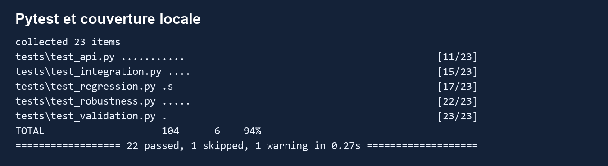

# Tests unitaires, fonctionnels et d’intégration

## Résultats des scénarios API

Précondition commune : modèle 1.0.0 chargé et demande du README. API-09 utilise une application démarrée avec un chemin d’artefact absent. Pour les erreurs 422, l’API fournit l’emplacement et le type d’erreur dans `detail`.

| Cas | Entrée | HTTP attendu / observé | Réponse et comportement observés |
| --- | --- | --- | --- |
| API-01 | Demande valide | 200 / 200 | Score 0,454323, risque faible, version 1.0.0 |
| API-02 | Âge omis | 422 / 422 | `missing` sur l’âge |
| API-03 | Âge −1 | 422 / 422 | `greater_than_equal` |
| API-04 | Revenu « 250000 » | 422 / 422 | `float_type` |
| API-05 | Montant 0 puis −1 | 422 / 422 | `greater_than` dans les deux cas |
| API-06 | Durée 12,5 | 422 / 422 | `int_type` |
| API-07 | Clé supplémentaire | 422 / 422 | `extra_forbidden` |
| API-08 | Montant 10¹² FCFA | 422 / 422 | `less_than_equal` |
| API-09 | Modèle absent | 503 / 503 | « Modèle indisponible » sur les trois routes |
| API-10 | Corps JSON tronqué | 422 / 422 | `json_invalid` |

Les dix scénarios représentent onze tests Pytest en raison des deux valeurs du montant. Les réponses complètes sont conservées dans [mesures.json](mesures.json).

## Intégration et test unitaire

| Cas | Vérification | Résultat observé |
| --- | --- | --- |
| INT-01 | Disponibilité, ordre des variables, calcul direct et version | 200, score cohérent, métadonnées alignées |
| INT-02 | Exception de prétraitement | 500, « Erreur de prédiction » |
| INT-03 | Dimensions incompatibles | 500, même message générique |
| INT-04 | Exception lors de la prédiction | 500, même message générique |
| UNIT-01 | Conservation des montants et revenus en FCFA | Test réussi |

La demande sans âge vérifie aussi que la validation intercepte l’entrée avant l’inférence. La suite complète obtient 22 succès, 1 cas volontaire ignoré et 94 % de couverture des instructions. Un avertissement de dépréciation provient de Starlette.

