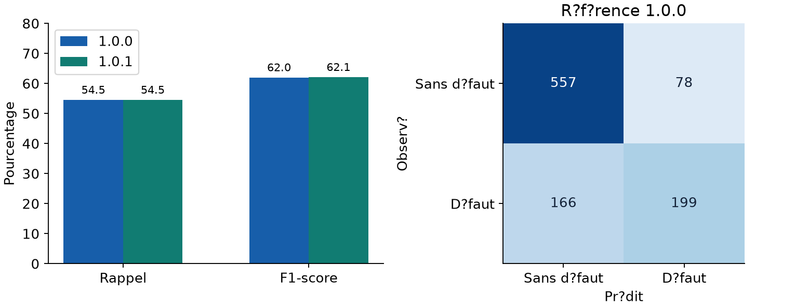

# Rapport de non-régression

La référence est le pipeline 1.0.0 livré. Le candidat expérimental 1.0.1 conserve les 600 demandes d’entraînement et change uniquement la régularisation de la régression logistique (`C=0.5`). La comparaison repose sur 1 000 nouvelles observations synthétiques générées avec la graine 2026, selon le même mécanisme de simulation. L’artefact candidat est produit pour le contrôle et utilisé temporairement.

Avant les mesures, le [protocole](protocole.json) fixe un seuil de classification de 0,5, une baisse maximale de 2 points de pourcentage pour le rappel et le F1-score et un écart de 10⁻¹² après rechargement du même modèle.

| Critère | Référence | Candidat | Écart | Bilan |
| --- | --- | --- | --- | --- |
| Rappel du défaut | 54,52 % | 54,52 % | 0,00 pt | Conforme |
| F1-score | 61,99 % | 62,09 % | +0,10 pt | Conforme |
| Faux négatifs / défauts simulés | 166 / 365 | 166 / 365 | 0 | Risque résiduel |
| Écart maximal après rechargement | 0 | 0 | 0 | Conforme |
| Contrat HTTP sur la demande témoin | 200, score fini, version 1.0.0 | 200, score fini, version 1.0.1 | Version attendue | Conforme |

La suite fonctionnelle complète est mesurée sur la référence. Le candidat a fait l’objet d’un contrôle du contrat HTTP sur la demande témoin et d’un contrôle de l’intervalle des 1 000 probabilités. Les deux versions manquent 45,48 % des défauts simulés. Les tolérances comparent les versions entre elles. L’acceptation métier demande ses propres seuils et des données représentatives.

