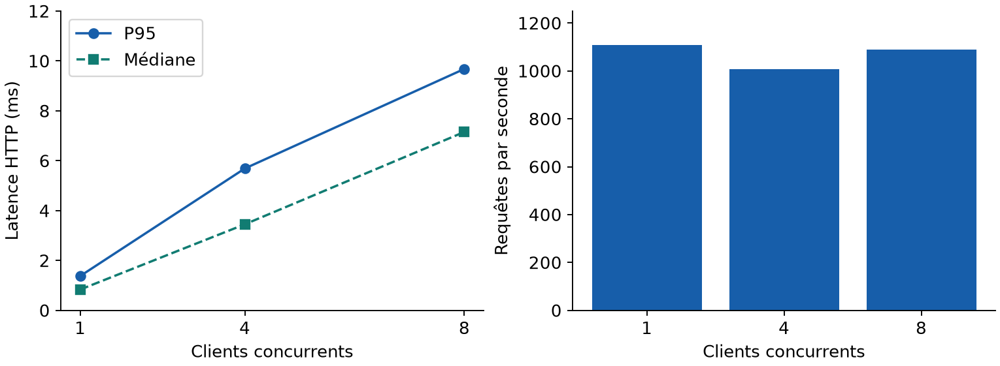

# Rapport de performance

La mesure locale utilise FastAPI TestClient et un appel direct à `predire`. Le chronométrage HTTP inclut le traitement de la requête ASGI et l’aller-retour client dans le processus Python. Un échauffement de 30 appels précède les mesures. Trois paliers de 240 requêtes sont exécutés avec 1, 4 et 8 clients concurrents. Le débit est le nombre de réponses rapporté au temps total du palier. L’inférence, mesurée sur 500 appels, comprend la transformation de la demande validée et la prédiction.

Environnement : Windows 11, Intel64 et 8 processeurs logiques, Python 3.13.2, FastAPI 0.115.12, scikit-learn 1.9.1 et HTTPX 0.28.1.

| Clients concurrents | Requêtes | Médiane HTTP (ms) | P95 HTTP (ms) | Débit (req/s) | Erreurs |
| --- | --- | --- | --- | --- | --- |
| 1 | 240 | 0,83 | 1,38 | 1 107 | 0 |
| 4 | 240 | 3,45 | 5,69 | 1 007 | 0 |
| 8 | 240 | 7,15 | 9,68 | 1 089 | 0 |

Inférence directe : médiane **0,136 ms**, P95 **0,233 ms**. L’objectif local (P95 ≤ 100 ms, débit ≥ 20 req/s, zéro erreur) sert à vérifier une marge pour un prototype interactif à faible volume. Les trois paliers le respectent. La hausse du P95 avec la concurrence mérite d’être suivie. Ces mesures en processus excluent le réseau, les proxies et la configuration du serveur de déploiement. Reproduire l’expérience avec la procédure locale en choisissant un nouveau dossier de sortie. Les chiffres ci-dessus et la figure correspondent à la campagne archivée dans [mesures.json](mesures.json).

