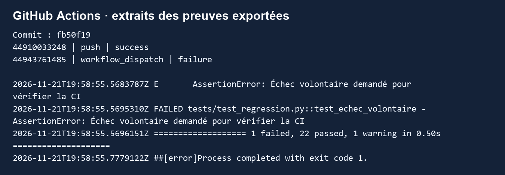

# Intégration continue et preuves d’exécution

Le [workflow](../.github/workflows/tests.yml) utilise Python 3.13 sur Ubuntu, installe les dépendances, exécute Ruff puis Pytest avec couverture et publie les fichiers JUnit et couverture. Il se déclenche sur push, pull request et lancement manuel. Les deux exécutions distantes vérifiées portent sur le commit `fb50f19` (« Premier commit »). Elles prouvent le fonctionnement du workflow et la remontée d’un échec déclenché manuellement. Les tests enrichis de la version de rendu ont été vérifiés localement avec **51 succès**, **95 % de couverture** et une **sortie 1** en mode volontaire. Une exécution distante du commit de rendu reste à vérifier après publication.

| Exécution | Déclenchement | Conclusion |
| --- | --- | --- |
| [44910033248](https://github.com/angnecheko/CreditRisk-Test/actions/runs/44910033248) | Push sur le dépôt | Succès |
| [44943761485](https://github.com/angnecheko/CreditRisk-Test/actions/runs/44943761485) | Manuel, `deliberate_failure=true` | Ruff réussi, 22 tests réussis, 1 assertion volontaire en échec, sortie 1, artefacts publiés |

Sources : [métadonnées du succès](preuves/ci-succes.json), [métadonnées de l’échec](preuves/ci-echec.json), [extrait réel du journal distant](preuves/ci-echec.txt). La figure est un rendu des preuves exportées.

Pour reproduire dans GitHub, ouvrir **Actions → Tests et qualité → Run workflow**, activer l’option d’échec volontaire et examiner l’étape Pytest. Un lancement normal laisse cette option désactivée. Le [README](../README.md) indique les commandes locales. Un [journal local d’échec volontaire](preuves/pytest-echec.txt) complète la preuve distante.
