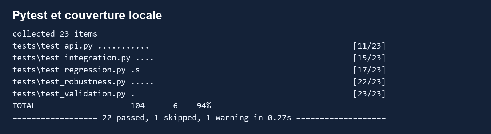
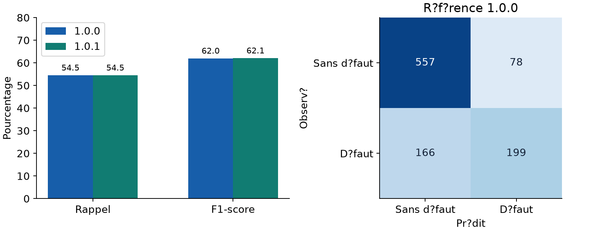
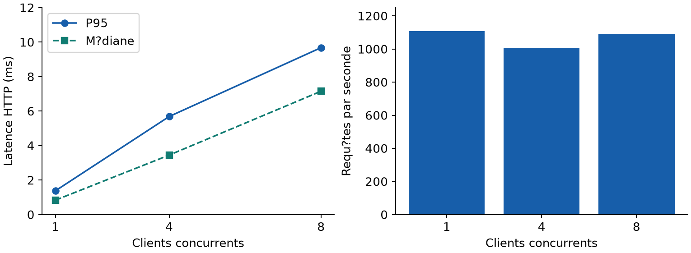
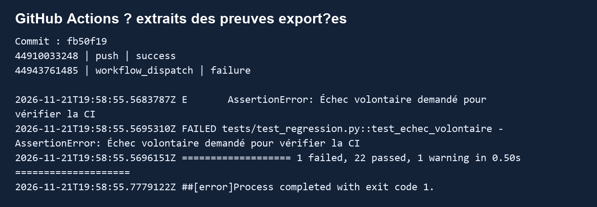

# Rapport final de qualification

**CreditRisk-Test · Évaluation formative 2**  
**Armand Alvain NGNECHEKO**

## Résumé et décision

Le prototype estime un risque de défaut à partir de cinq variables. Les éléments vérifiés permettent de poursuivre les essais techniques sur données synthétiques. Le passage à un pilote sur de vrais dossiers est à différer. Les deux versions manquent 166 défauts simulés sur 365 et l’API accepte certains dossiers atypiques ou incohérents sans signalement.

## Contexte et exigences

Le service valide les données, construit le vecteur d’entrée, applique la régression logistique et retourne une probabilité, une classe de risque et une version. L’entraînement repose sur 600 demandes synthétiques. Le corpus de comparaison comprend 1 000 observations synthétiques indépendantes de l’entraînement. La validation technique couvre les trois endpoints, le traitement des entrées invalides, les erreurs internes, la stabilité après rechargement et la performance locale.

## Stratégie et traçabilité

Le [plan de test](01_plan_de_test.md) relie 13 exigences à des cas et à un risque. Les erreurs qui peuvent affecter un score ou empêcher le service sont prioritaires. Les cas nominaux sont complétés par des contrôles de limites, des injections de défaillances et une comparaison après modification du modèle.

## Tests fonctionnels et intégration

La suite locale compte **22 tests réussis**, **1 test volontaire ignoré** et **94 % de couverture**. Les dix scénarios obligatoires de l’API ont donné les codes et réponses attendus. Le test d’intégration nominal confirme le score du pipeline et sa version. Les trois erreurs injectées retournent un message générique et un statut 500. Le [tableau des résultats](02_tests_et_integration.md) détaille les scénarios.

## Robustesse et anomalies

Les entrées absentes, non numériques, non finies et mal structurées sont rejetées. Les bornes d’âge sont acceptées. Deux observations sont classées majeures avant pilote : un montant valide mais éloigné de l’entraînement passe sans alerte, et une ancienneté incompatible avec l’âge passe sans contrôle croisé. L’avertissement de dépréciation Starlette est mineur. Le [registre](03_robustesse.md) associe chaque observation à une correction.

## Non-régression

La référence 1.0.0 obtient un rappel de 54,52 % et un F1-score de 61,99 %. Le candidat expérimental 1.0.1 maintient le rappel et atteint 62,09 % en F1. L’écart après rechargement est nul sur les 1 000 cas pour les deux versions. Les tolérances de comparaison sont respectées. Le [rapport de non-régression](04_non_regression.md) précise la portée des vérifications.

## Performance

Le P95 HTTP en processus passe de 1,38 ms à 9,68 ms entre 1 et 8 clients concurrents. Le débit varie d’environ 1 007 à 1 107 requêtes/s et aucune des 720 requêtes chronométrées n’échoue. Le P95 d’inférence est de 0,233 ms. Les objectifs locaux sont atteints. Le [rapport de performance](05_performance.md) décrit le matériel, le protocole et les limites.

## Automatisation

Le workflow a réussi sur push. Le déclenchement manuel avec échec volontaire a propagé le code 1 dans GitHub Actions et a conservé les artefacts. Les deux exécutions et l’extrait du journal sont liés dans le [rapport d’intégration continue](06_integration_continue.md).

## Limites et recommandation pour la phase pilote

Le corpus synthétique permet de qualifier les parcours logiciels et de comparer des versions dans des conditions contrôlées. La performance du modèle sur des dossiers réels, l’équité entre profils et la conformité du processus de crédit restent à établir. Les mesures en processus doivent être complétées sur l’environnement cible.

Des faux négatifs élevés pour certains profils signifient que des dossiers qui devraient être orientés vers un examen renforcé risquent de passer sous le seuil. Avant d’autoriser un pilote, il faut valider les taux d’erreurs et la calibration sur des données représentatives, vérifier les écarts entre profils avec des effectifs suffisants, convenir de seuils métier et prévoir une revue humaine et une procédure de suivi. Les contrôles de cohérence et le traitement des entrées hors distribution font partie des conditions techniques à lever.
