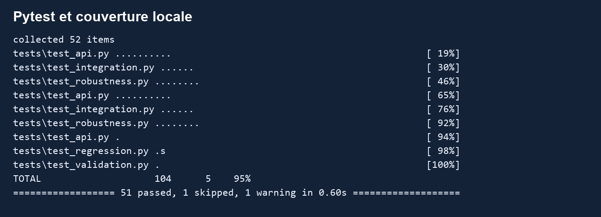
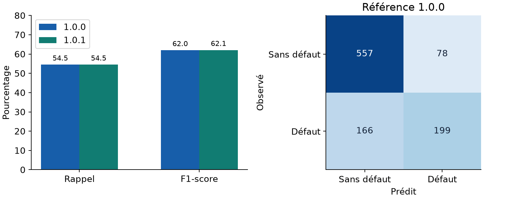
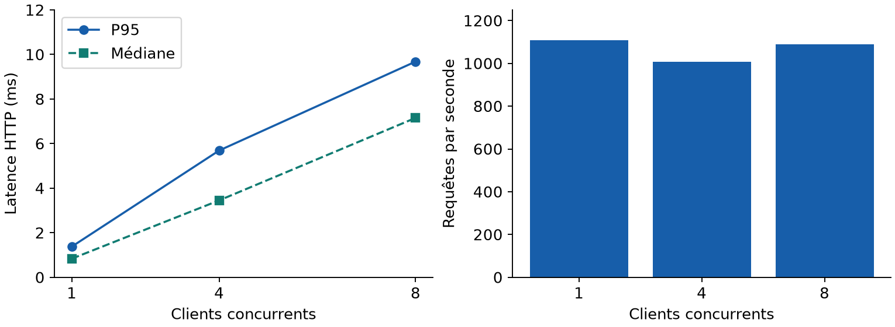
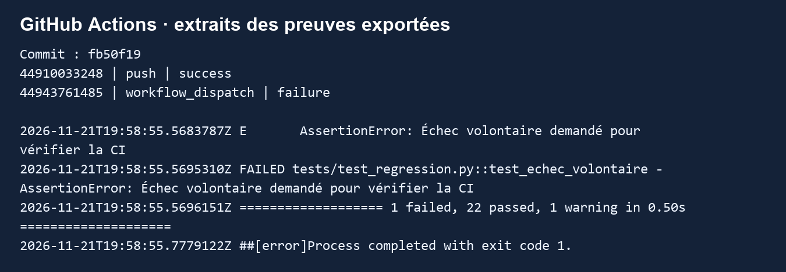

# CreditRisk-Test — Rapport consolidé de qualification

**Évaluation formative 2 · Armand Alvain NGNECHEKO**

[Dépôt GitHub CreditRisk-Test](https://github.com/angnecheko/CreditRisk-Test)

## Sommaire

- [Résumé](#résumé)
- [Contexte et périmètre](#contexte-et-périmètre)
- [1. Plan de test et matrice de traçabilité](#1-plan-de-test-et-matrice-de-traçabilité)
- [2. Tests unitaires, fonctionnels et d’intégration](#2-tests-unitaires-fonctionnels-et-dintégration)
- [3. Robustesse et registre des anomalies](#3-robustesse-et-registre-des-anomalies)
- [4. Rapport de non-régression](#4-rapport-de-non-régression)
- [5. Rapport de performance](#5-rapport-de-performance)
- [6. Intégration continue et preuves d’exécution](#6-intégration-continue-et-preuves-dexécution)
- [7. Décision de qualification et limites](#7-décision-de-qualification-et-limites)
- [8. Exécution locale sous PowerShell](#8-exécution-locale-sous-powershell)
- [Sources et reproduction](#sources-et-reproduction)

## Résumé

Le prototype estime un risque de défaut à partir de cinq variables. Les éléments vérifiés permettent de poursuivre les essais techniques sur données synthétiques. Le passage à un pilote sur de vrais dossiers est à différer. Les deux versions manquent 166 défauts simulés sur 365 et l’API accepte certains dossiers atypiques ou incohérents sans signalement.

## Contexte et périmètre

Le service valide les données, construit le vecteur d’entrée, applique la régression logistique et retourne une probabilité, une classe de risque et une version. L’entraînement repose sur 600 demandes synthétiques. Le corpus de comparaison comprend 1 000 observations synthétiques indépendantes de l’entraînement. La validation technique couvre les trois endpoints, le traitement des entrées invalides, les erreurs internes, la stabilité après rechargement et la performance locale.

## 1. Plan de test et matrice de traçabilité

Le périmètre couvre la validation stricte, le prétraitement, la régression logistique et l’API FastAPI. Les 600 demandes d’entraînement sont synthétiques. Les règles métier pour une utilisation réelle restent à établir.

Pour chaque cas, D désigne la demande de référence du README. Les tests HTTP supposent une API initialisée avec le modèle 1.0.0, sauf EX05. P1 indique un risque susceptible de bloquer ou d’altérer une décision. P2 indique un risque de dégradation de service ou de traçabilité. Les tests unitaires et fonctionnels précèdent l’intégration, la robustesse, la comparaison ML et la mesure de performance.

| ID | Exigence et entrée | Cas et résultat attendu | Risque / priorité |
| --- | --- | --- | --- |
| EX01 | Âge entier de 18 à 100, D modifiée | API-03 âge −1 → 422. ROB-02 âges 18 et 100 → 200 | Entrée incohérente / P1 |
| EX02 | Revenu numérique, positif et fini | API-04 chaîne → 422. ROB-01 valeurs non finies → 422 | Calcul invalide / P1 |
| EX03 | Durée entière de 1 à 120 mois | API-06 durée 12,5 → 422 | Unité ou durée incohérente / P1 |
| EX04 | Probabilité finie comprise entre 0 et 1 | API-01 avec D → 200 et score dans l’intervalle | Score inexploitable / P1 |
| EX05 | Artefact absent au démarrage | API-09 avec chemin inexistant → 503 sur les trois endpoints | Service indisponible / P1 |
| EX06 | Tous les champs requis sont présents | API-02 D sans âge → 422 | Prédiction sur données incomplètes / P1 |
| EX07 | Les critères critiques se maintiennent | NR-01 référence et candidat sur 1 000 observations → baisses dans les tolérances | Régression du risque / P1 |
| EX08 | Montant strictement positif et plafonné | API-05 montant nul ou négatif et API-08 montant supérieur au plafond → 422 | Demande financière incohérente / P1 |
| EX09 | Schéma strict et JSON valide | API-07 clé inconnue, API-10 JSON tronqué, ROB-03 liste JSON → 422 | Entrée ambiguë / P1 |
| EX10 | Ordre des variables et version cohérents | INT-01 D → score égal au calcul direct et version égale aux métadonnées | Erreur silencieuse de pipeline / P1 |
| EX11 | Erreurs internes contrôlées | INT-02 à INT-05 injection d’erreur et dimensions invalides → 500 générique | Fuite de détails / P1 |
| EX12 | Prédiction stable après rechargement | NR-02 sauvegarde puis chargement → écart absolu ≤ 10⁻¹² | Déploiement non reproductible / P1 |
| EX13 | Objectif de performance locale | PERF-01 charge 1, 4 et 8 → P95 ≤ 100 ms, ≥ 20 req/s, aucune erreur | Temps de réponse excessif / P2 |

### Correspondance avec les tests exécutables

Les cas qui utilisent le client HTTP sont exécutés avec un artefact chargé pour chacune des versions 1.0.0 et 1.0.1. Les vérifications d’absence d’artefact et les mesures de performance ont les préconditions spécifiques indiquées ci-dessous.

| Exigence | Cas et fonction Pytest ou commande | Préparation et données spécifiques |
| --- | --- | --- |
| EX01 | API-03 `test_entree_invalide`, ROB-02 `test_accepte_les_bornes_de_l_age` | Remplacer uniquement l’âge par −1, 18 ou 100 |
| EX02 | API-04 `test_entree_invalide`, ROB-01 `test_rejette_les_revenus_non_finis` | Remplacer le revenu par la chaîne « 250000 », NaN, +∞ ou −∞ |
| EX03 | API-06 `test_entree_invalide` | Remplacer la durée par 12,5 mois |
| EX04 | API-01 `test_prediction_valide` | Envoyer D et contrôler aussi le niveau et la version |
| EX05 | API-09 `test_modele_indisponible`, INT-06 `test_artefact_incompatible` | Démarrer avec un chemin inexistant, puis avec des métadonnées de variables incompatibles |
| EX06 | API-02 `test_champ_manquant` | Supprimer l’âge de D |
| EX07 | NR-01 `reports.protocole_executable` et suite fonctionnelle | Entraîner les deux versions sur les mêmes 600 observations. Comparer les métriques sur 1 000 observations distinctes |
| EX08 | API-05 et API-08 `test_entree_invalide` | Remplacer le montant par 0, −1 ou 10¹² FCFA |
| EX09 | API-07 `test_entree_invalide`, API-10 `test_json_mal_forme`, ROB-03 `test_rejette_un_tableau_json` | Ajouter `extra=true`, envoyer le corps tronqué `{` ou le tableau vide `[]` |
| EX10 | INT-01 `test_pipeline_http` | Envoyer D et calculer indépendamment le score avec les colonnes dans l’ordre de l’artefact |
| EX11 | INT-02 à INT-05 `test_erreur_interne_controlee` | Injecter une exception de transformation, un vecteur à une colonne, une exception de prédiction ou un `KeyError` après validation |
| EX12 | NR-02 `test_probabilite_apres_rechargement` et `reports.protocole_executable` | Sérialiser le modèle, puis comparer la prédiction avant et après chargement sur D et sur le corpus |
| EX13 | PERF-01 `reports.protocole_executable` | Charger la référence, échauffer 30 appels, envoyer 240 demandes D à chacun des trois paliers |

## 2. Tests unitaires, fonctionnels et d’intégration

### Résultats des scénarios API

Précondition commune : modèle 1.0.0 chargé et demande du README. API-09 utilise une application démarrée avec un chemin d’artefact absent. Pour les erreurs 422, l’API fournit l’emplacement et le type d’erreur dans `detail`.

| Cas | Entrée | HTTP attendu / observé | Corps et comportement attendus | Résultat observé |
| --- | --- | --- | --- | --- |
| API-01 | D complète | 200 / 200 | Score fini dans [0,1], niveau selon le seuil de 0,5 et version de l’artefact | 0,454323 / risque faible / 1.0.0. Avec le candidat, 0,453576 / risque faible / 1.0.1 |
| API-02 | Âge omis | 422 / 422 | Erreur `missing` localisée sur l’âge, rejet avant prédiction | Conforme |
| API-03 | Âge −1 | 422 / 422 | Erreur `greater_than_equal` sur l’âge, rejet | Conforme |
| API-04 | Revenu « 250000 » | 422 / 422 | Erreur `float_type` sur le revenu, rejet sans conversion | Conforme |
| API-05 | Montant 0 puis −1 | 422 / 422 | Erreur `greater_than` sur le montant, rejet | Même erreur pour les deux valeurs |
| API-06 | Durée 12,5 | 422 / 422 | Erreur `int_type` sur la durée, rejet sans arrondi | Conforme |
| API-07 | Clé supplémentaire | 422 / 422 | Erreur `extra_forbidden` sur la clé, rejet | Conforme |
| API-08 | Montant 10¹² FCFA | 422 / 422 | Erreur `less_than_equal` sur le montant, rejet | Conforme |
| API-09 | D et artefact absent | 503 / 503 | `detail` vaut « Modèle indisponible » sur les trois routes | Conforme sur les trois routes |
| API-10 | Corps JSON tronqué | 422 / 422 | Erreur `json_invalid`, rejet du corps | Conforme |

Les scénarios avec un client initialisé sont rejoués sur la référence et le candidat. Le contrôle d’artefact absent est commun aux deux versions. Les [réponses détaillées de la référence](mesures.json) et le [journal JUnit des deux versions](preuves/junit.xml) permettent de vérifier les résultats.

### Intégration et test unitaire

| Cas | Vérification | Résultat observé |
| --- | --- | --- |
| INT-01 | Disponibilité, ordre des variables, calcul direct et version | 200, score cohérent, métadonnées alignées |
| INT-02 | Exception de prétraitement | 500, « Erreur de prédiction » |
| INT-03 | Dimensions incompatibles | 500, même message générique |
| INT-04 | Exception lors de la prédiction | 500, même message générique |
| INT-05 | Variable indisponible après validation, simulée par un `KeyError` de transformation | 500, message générique sans nom de variable |
| INT-06 | Artefact chargé avec une liste de variables incompatible | 503, « Modèle indisponible » |
| API-02 et API-09 | Champ manquant à la frontière HTTP et artefact absent | 422 avant prédiction et 503 sur les trois routes |
| UNIT-01 | Conservation des montants et revenus en FCFA | Test réussi |

La demande sans âge vérifie aussi que la validation intercepte l’entrée avant l’inférence. La suite locale obtient 51 succès, 1 cas volontaire ignoré et 95 % de couverture des instructions. Un avertissement de dépréciation provient de Starlette.



## 3. Robustesse et registre des anomalies

| Cas | Risque visé | Comportement attendu | Observé | Anomalie |
| --- | --- | --- | --- | --- |
| ROB-01 | Calcul sur NaN ou infini | Rejet des trois valeurs non finies | 422, `finite_number` | Aucune |
| ROB-02 | Rejet incorrect des bornes | Acceptation des âges 18 et 100 | 200 aux deux bornes | Aucune |
| ROB-03 | Schéma incorrect | Rejet d’une liste JSON et des champs supplémentaires | 422, `model_attributes_type` ou `extra_forbidden` | Aucune |
| ROB-04 | Imputation implicite ou conversion d’une chaîne | Rejet d’un champ manquant et d’un revenu texte | 422, `missing` ou `float_type` | Aucune |
| ROB-05 | Score peu fiable hors distribution | Valeur dans le schéma acceptée et signalement souhaité pour examen | 200 pour 1 milliard FCFA, sans alerte | A01 · majeure avant pilote |
| ROB-06 | Profil contradictoire | Rejet ou signalement souhaité pour âge 35 et ancienneté 82 ans | 200, sans contrôle croisé | A02 · majeure avant pilote |

Le tableau JSON vide est rejeté par `test_rejette_un_tableau_json`. Les deux entrées inhabituelles sont désormais contrôlées par `test_entrees_valides_selon_le_schema` pour les deux modèles. Le test fixe le contrat actuel : HTTP 200 et probabilité conforme. Le signalement hors distribution et la cohérence croisée restent des exigences métier à définir avant le pilote. Les [réponses détaillées](mesures.json) et le [journal des assertions](preuves/junit.xml) conservent les résultats.

| Anomalie et cas source | Gravité proposée | Correction recommandée | Statut |
| --- | --- | --- | --- |
| A01 (ROB-05) · Pas de signalement hors distribution | Majeure avant pilote | Définir les plages avec le métier et orienter les dossiers signalés vers une revue humaine | Ouverte |
| A02 (ROB-06) · Ancienneté incompatible avec l’âge | Majeure avant pilote | Définir une règle métier de cohérence croisée puis ajouter des tests | Ouverte |
| A03 (journal Pytest) · Dépréciation Starlette | Mineure | Vérifier la compatibilité des dépendances lors de leur prochaine mise à jour | Ouverte |

## 4. Rapport de non-régression

La référence est le pipeline 1.0.0 livré. Le candidat expérimental 1.0.1 conserve les 600 demandes d’entraînement et change uniquement la régularisation de la régression logistique (`C=0.5`). La comparaison repose sur 1 000 nouvelles observations synthétiques générées avec la graine 2026, selon le même mécanisme de simulation. L’artefact candidat est produit pour le contrôle et utilisé temporairement.

Avant les mesures, le [protocole](protocole.json) fixe un seuil de classification de 0,5, une baisse maximale de 2 points de pourcentage pour le rappel et le F1-score et un écart de 10⁻¹² après rechargement du même modèle.

| Critère | Référence | Candidat | Écart | Bilan |
| --- | --- | --- | --- | --- |
| Rappel du défaut | 54,52 % | 54,52 % | 0,00 pt | Conforme |
| F1-score | 61,99 % | 62,09 % | +0,10 pt | Conforme |
| Faux négatifs / défauts simulés | 166 / 365 | 166 / 365 | 0 | Risque résiduel |
| Écart maximal après rechargement | 0 | 0 | 0 | Conforme |
| Contrat HTTP sur la demande témoin | 200, score fini, version 1.0.0 | 200, score fini, version 1.0.1 | Version attendue | Conforme |

Les tests d’API, d’intégration et de robustesse passent sur chacun des deux modèles. Pour le candidat, la sélection ciblée donne **25 succès** : 24 cas utilisant le modèle 1.0.1 et 1 vérification commune du modèle absent. Les mêmes assertions portent sur les codes HTTP, le schéma de sortie, la cohérence du niveau de risque, les métadonnées et les erreurs. Le calcul sur le corpus confirme également que les 1 000 probabilités sont finies et dans l’intervalle attendu. [Preuve JUnit des deux versions](preuves/junit.xml). Les deux versions manquent 45,48 % des défauts simulés. Les tolérances comparent les versions entre elles. L’acceptation métier demande ses propres seuils et des données représentatives.



## 5. Rapport de performance

La mesure locale utilise FastAPI TestClient et un appel direct à `predire`. Le chronométrage HTTP inclut le traitement de la requête ASGI et l’aller-retour client dans le processus Python. Un échauffement de 30 appels précède les mesures. Trois paliers de 240 requêtes sont exécutés avec 1, 4 et 8 clients concurrents. Le débit est le nombre de réponses rapporté au temps total du palier. L’inférence, mesurée sur 500 appels, comprend la transformation de la demande validée et la prédiction.

Environnement : Windows 11, Intel64 et 8 processeurs logiques, Python 3.13.2, FastAPI 0.115.12, scikit-learn 1.9.1 et HTTPX 0.28.1.

| Clients concurrents | Requêtes | Médiane HTTP (ms) | P95 HTTP (ms) | Débit (req/s) | Erreurs |
| --- | --- | --- | --- | --- | --- |
| 1 | 240 | 0,83 | 1,38 | 1 107 | 0 |
| 4 | 240 | 3,45 | 5,69 | 1 007 | 0 |
| 8 | 240 | 7,15 | 9,68 | 1 089 | 0 |

Inférence directe : médiane **0,136 ms**, P95 **0,233 ms**. L’objectif local (P95 ≤ 100 ms, débit ≥ 20 req/s, zéro erreur) sert à vérifier une marge pour un prototype interactif à faible volume. Les trois paliers le respectent. La hausse du P95 avec la concurrence mérite d’être suivie. Ces mesures en processus excluent le réseau, les proxies et la configuration du serveur de déploiement. Reproduire l’expérience avec la procédure locale en choisissant un nouveau dossier de sortie. Les chiffres ci-dessus et la figure correspondent à la campagne archivée dans [mesures.json](mesures.json).



## 6. Intégration continue et preuves d’exécution

Le [workflow](../.github/workflows/tests.yml) utilise Python 3.13 sur Ubuntu, installe les dépendances, exécute Ruff puis Pytest avec couverture et publie les fichiers JUnit et couverture. Il se déclenche sur push, pull request et lancement manuel. Les deux exécutions distantes vérifiées portent sur le commit `fb50f19` (« Premier commit »). Elles prouvent le fonctionnement du workflow et la remontée d’un échec déclenché manuellement. Les tests enrichis de la version de rendu ont été vérifiés localement avec **51 succès**, **95 % de couverture** et une **sortie 1** en mode volontaire. Une exécution distante du commit de rendu reste à vérifier après publication.

| Exécution | Déclenchement | Conclusion |
| --- | --- | --- |
| [44910033248](https://github.com/angnecheko/CreditRisk-Test/actions/runs/44910033248) | Push sur le dépôt | Succès |
| [44943761485](https://github.com/angnecheko/CreditRisk-Test/actions/runs/44943761485) | Manuel, `deliberate_failure=true` | Ruff réussi, 22 tests réussis, 1 assertion volontaire en échec, sortie 1, artefacts publiés |



Sources : [métadonnées du succès](preuves/ci-succes.json), [métadonnées de l’échec](preuves/ci-echec.json), [extrait réel du journal distant](preuves/ci-echec.txt). La figure est un rendu des preuves exportées.

Pour reproduire dans GitHub, ouvrir **Actions → Tests et qualité → Run workflow**, activer l’option d’échec volontaire et examiner l’étape Pytest. Un lancement normal laisse cette option désactivée. Le [README](../README.md) indique les commandes locales. Un [journal local d’échec volontaire](preuves/pytest-echec.txt) complète la preuve distante.

## 7. Décision de qualification et limites

Le corpus synthétique permet de qualifier les parcours logiciels et de comparer des versions dans des conditions contrôlées. La performance du modèle sur des dossiers réels, l’équité entre profils et la conformité du processus de crédit restent à établir. Les mesures en processus doivent être complétées sur l’environnement cible.

Des faux négatifs élevés pour certains profils signifient que des dossiers qui devraient être orientés vers un examen renforcé risquent de passer sous le seuil. Avant d’autoriser un pilote, il faut valider les taux d’erreurs et la calibration sur des données représentatives, vérifier les écarts entre profils avec des effectifs suffisants, convenir de seuils métier et prévoir une revue humaine et une procédure de suivi. Les contrôles de cohérence et le traitement des entrées hors distribution font partie des conditions techniques à lever.

## 8. Exécution locale sous PowerShell

Exécuter ces commandes depuis la racine du dépôt. Si nécessaire, cloner d’abord le dépôt avec un compte GitHub qui dispose de l’accès.

```powershell
git clone https://github.com/angnecheko/CreditRisk-Test.git
Set-Location CreditRisk-Test
```

### Préparer Python et entraîner le modèle

Le projet utilise Python 3.13. La commande d’entraînement écrit l’artefact local `model.joblib`.

```powershell
py -3.13 -m venv .venv
.\.venv\Scripts\python.exe --version
.\.venv\Scripts\python.exe -m pip install -r requirements.txt
.\.venv\Scripts\python.exe -m app.training
```

### Lancer et interroger FastAPI

Dans un premier terminal, garder le serveur actif.

```powershell
.\.venv\Scripts\python.exe -m uvicorn app.main:app --host 127.0.0.1 --port 8000
```

Dans un deuxième terminal PowerShell, interroger les trois endpoints. La première réponse indique `disponible`, la deuxième expose la version `1.0.0` et ses variables, et la troisième contient une probabilité finie, le niveau de risque et la version. Arrêter le serveur avec Ctrl+C après la vérification.

```powershell
$base = 'http://127.0.0.1:8000'
Invoke-RestMethod -Uri "$base/health"
Invoke-RestMethod -Uri "$base/model-info"
$demande = @{
    age = 35
    revenu_mensuel = 250000
    montant_credit = 1000000
    duree_mois = 12
    anciennete_activite = 4
} | ConvertTo-Json
Invoke-RestMethod -Uri "$base/predict" -Method Post -ContentType 'application/json' -Body $demande
```

### Exécuter Ruff, les tests et la couverture

Les tests démarrent leur propre application et construisent des artefacts temporaires. Les commandes exportent les résultats dans un dossier de travail temporaire distinct des preuves archivées.

```powershell
$sortie = Join-Path $env:TEMP ('creditrisk-tp2-' + [guid]::NewGuid())
New-Item -ItemType Directory -Path $sortie | Out-Null
Remove-Item Env:CREDITRISK_ECHEC_VOLONTAIRE -ErrorAction SilentlyContinue
.\.venv\Scripts\python.exe -m ruff check .
$pytestArgs = @(
    '--cov=app'
    '--cov-report=term-missing'
    "--cov-report=xml:$sortie/coverage.xml"
    "--junitxml=$sortie/junit.xml"
)
.\.venv\Scripts\python.exe -m pytest @pytestArgs
```

Résultat de référence de la version enrichie : 51 succès, 1 test volontaire ignoré, 95 % de couverture. Pour vérifier précisément la version candidate, exécuter la sélection ci-dessous. Elle donne 25 succès, y compris le contrôle du modèle absent partagé entre les versions.

```powershell
.\.venv\Scripts\python.exe -m pytest -q tests/test_api.py tests/test_integration.py tests/test_robustness.py -k '1.0.1 or test_modele_indisponible'
```

### Reproduire la comparaison et la performance

Le protocole écrit `protocole.json` et `mesures.json` dans le dossier indiqué. Le rappel et le F1 sont reproductibles avec les mêmes dépendances. Les temps et le débit varient selon la machine et la charge.

```powershell
$reproduction = Join-Path $sortie 'mesures'
.\.venv\Scripts\python.exe -m reports.protocole_executable --output-dir $reproduction
Get-ChildItem $reproduction
```

### Reproduire l’échec volontaire en local

L’activation vaut pour le terminal courant pendant ce contrôle. Le résultat attendu est 1 échec volontaire, 51 succès et un code de sortie 1. Le bloc `finally` retire la variable après le test.

```powershell
$env:CREDITRISK_ECHEC_VOLONTAIRE = '1'
try {
    .\.venv\Scripts\python.exe -m pytest -q
    $code = $LASTEXITCODE
    "Code de sortie Pytest : $code"
} finally {
    Remove-Item Env:CREDITRISK_ECHEC_VOLONTAIRE
}
```

## Sources et reproduction

- [Protocole et critères d’acceptation](protocole.json)
- [Mesures de l’API, de la non-régression et de la performance](mesures.json)
- [Sortie locale Pytest](preuves/pytest.txt) · [JUnit](preuves/junit.xml) · [Couverture XML](preuves/coverage.xml)
- [Commandes et index des rapports](README.md)
